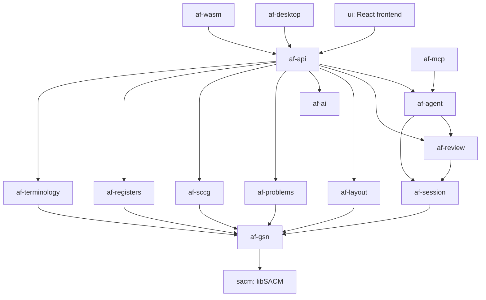

# Architecture

This file describes the shape of Assurance Forge and the rules its code follows.
It is kept short and current. Why a rule exists is recorded in the decision
records under `docs/decisions/`, once there are any; the reasoning so far is in
the [Phase 0 page](docs/roadmap/rust-rebuild-phase-0.md).

**Most of this is planned, not built.** The "Built" column below is the truth
about what exists.

## Goals

1. **GSN for people, SACM underneath.** Users work in GSN. The tool stays simple
   without preventing anyone from building an argument the way the standards
   intend.
2. **The case belongs to the user.** A case is a standard SACM 2.3 XMI file. The
   tool never silently changes or reinterprets an argument, and nothing leaves
   the machine without consent.
3. **One model.** The SACM document is the only model. Everything shown is
   derived from it; every change is a SACM operation.
4. **Fast to change.** A small change is checked in seconds locally and in
   minutes in CI.
5. **Desktop and web.** The tool runs as a standalone desktop application,
   built with Tauri, and as a web application in the browser, with the core
   compiled to WebAssembly. Both have the same interface and the same core;
   only the shell differs.

## The system

## Crates

| Crate | Owns | Built |
|---|---|---|
| `sacm` | The SACM model, XMI, validation, edits. External: [libSACM](https://github.com/lasrod/libSACM) | external |
| `af-gsn` | GSN view of a document, GSN commands, identifiers, well-formedness checks | view (reading rules in `docs/standards/sacm-gsn-mapping.md`); commands and checks no |
| `af-layout` | Text measurement, diagram layout, positioned render model, SVG export | layout and render model; SVG export no |
| `af-session` | Open document, revisions, change stream, undo, drafts, storage trait | no |
| `af-problems` | The problem list and its attention model | no |
| `af-sccg` | Guideline catalogue and mechanical checks | no |
| `af-registers` | Evidence and CSE registers | no |
| `af-terminology` | Terminology assist and term usage | no |
| `af-review` | Review methods: scope, prompt and result contracts, result validation | no |
| `af-ai` | Provider profiles and inference; knows nothing about SACM or GSN | no |
| `af-agent` | Operations an external agent may request | no |
| `af-api` | The frontend contract: commands, queries, views | open, diagram and element queries; TypeScript types in `crates/af-api/bindings/api.ts` |
| `af-desktop` | Tauri shell: files, dialogs, secret storage, HTTP, local bridge | no |
| `af-mcp` | MCP server executable | no |
| `af-wasm` | Web application shell: `af-api` in the browser, browser file access | no |
| `ui/` | React and DATUM frontend | no |

A crate is added when it can be built and tested without the rest.

## Rules

| Rule | Enforced by |
|---|---|
| Every crate down to `af-api` is pure: no file system, network, threads or clock. Those arrive through traits the shells implement. | CI builds these crates for `wasm32-unknown-unknown` |
| `af-review` and `af-ai` never depend on each other. `af-ai` depends on no other crate of ours. | Cargo dependencies; not yet checked |
| Only `af-desktop`, `af-mcp` and `af-wasm` touch the outside world. | The first rule |
| Every feature works in the desktop and the web application. The interface talks to the core through one interface with two implementations, Tauri commands and `af-wasm`. | not yet checked |
| No `unsafe`. | `unsafe_code = "forbid"` in the workspace lints |
| The core sends codes and arguments, never sentences. The frontend translates. | not yet checked |

## How a change flows

1. The frontend sends a **command**: a requested change.
2. The session expands it into SACM operations and applies them all or not at
   all.
3. A successful command produces one **change record** (revision, command,
   mutations, origin) on the session's change stream.
4. Views are derived again from the new revision, and the frontend receives an
   **event**.
5. The frontend asks for the **views** it shows. Each carries its revision, and
   an answer older than what is on screen is dropped.

The interface, AI review and MCP agents all use the same commands. Selection,
pan, zoom and open panels stay in the frontend.

## Files

One case is one SACM XMI file. Working state that is not part of the argument
(the AI working draft, review items, translation review state, the recovery
copy) lives in a folder beside it, `<file>.af/`. Deleting that folder loses
working state, never argument content.

## What is deliberately absent

- A second model of the argument. There is no GSN model that can be edited.
- A project format, manifest or file hashing.
- Sentences in the core. Text for people is produced in the frontend.

## Repository layout

| Path | Holds |
|---|---|
| `crates/` | The Rust workspace |
| `docs/` | The documentation site: roadmap, standards notes, reference |
| `testdata/sacm/` | Sample SACM files |
| `i18n/` | Translation catalogues carried over from the C++ application |
| `assets/` | The application icon |
| `examples/` | Example cases (submodule) |
| `external/safety-case-core-guidelines/` | The SCCG catalogue (submodule) |
