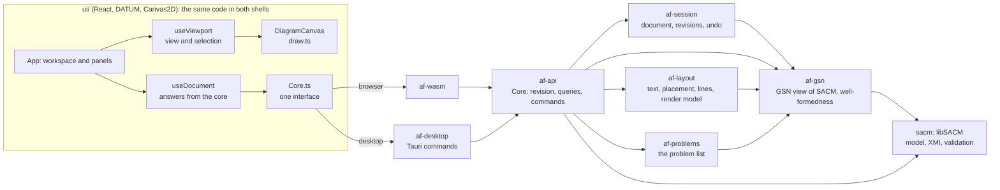
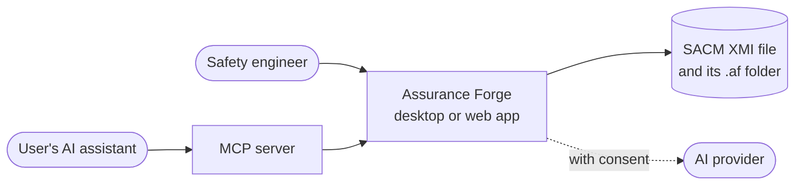
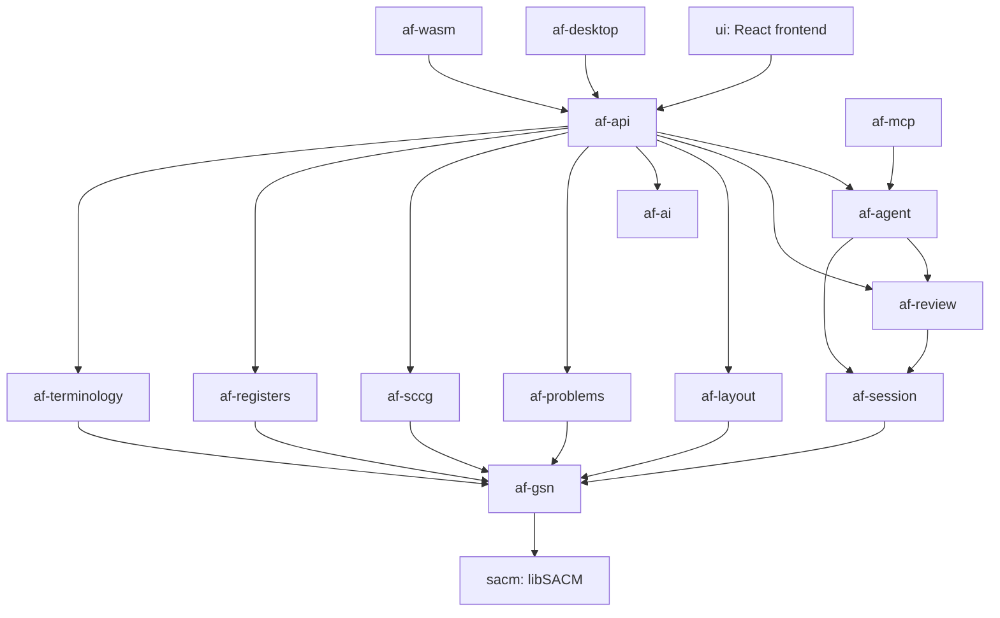

# Architecture

This file describes the shape of Assurance Forge and the rules its code follows.
It is kept short and current. It says first what is **built**, then what is
**planned**. Why a rule exists is recorded in the decision records under
`docs/decisions/`, once there are any; the reasoning so far is in the
[Phase 0 page](docs/roadmap/rust-rebuild-phase-0.md).

## Goals

1. **GSN for people, SACM underneath.** Users work in GSN. The tool stays simple
   without preventing anyone from building an argument the way the standards
   intend.
2. **The case belongs to the user.** A case is a standard SACM 2.3 XMI file. The
   tool never silently changes or reinterprets an argument, and nothing leaves
   the machine without consent.
3. **One model.** The SACM document is the only model. Everything shown is
   derived from it; every change is a SACM operation.
4. **Fast to change.** A small change is checked in seconds locally and in
   minutes in CI.
5. **Desktop and web.** The tool runs as a standalone desktop application,
   built with Tauri, and as a web application in the browser, with the core
   compiled to WebAssembly. Both have the same interface and the same core;
   only the shell differs.

## What is built

Milestone 1, step 1 ([the diagram](docs/roadmap/milestone-1-diagram.md)): a
viewer. A SACM 2.3 file opens in the desktop or the web application and is
drawn as a GSN diagram in a workspace with a Case Explorer, an Argument
Navigator, Element Properties and a Problems panel. Milestone 1, step 2
([the problem list](docs/roadmap/milestone-1-problems.md)): the Problems panel
lists what libSACM reported reading the file, what its validation finds, where
the argument breaks GSN's rules (cycles, connections GSN does not permit, a
Strategy out of place or with no Goal, shared identifiers, a stale undeveloped
mark) and what the diagram does not draw. It follows every edit, the status
bar counts it, and choosing a problem shows its element. Milestone 2,
step 1 ([adding elements](docs/roadmap/milestone-2-add-elements.md)): an
element is added from a right-click menu, and Edit ▸ Undo and Redo take it
back and bring it again. A node's identifier, name and description are
changed in Element Properties, each change one undo step. A node is removed
from the same menu or with Delete, with what is under it after the user has
seen the list. Milestone 2, step 2 ([saving](docs/roadmap/milestone-2-save.md)):
File ▸ Save writes the case back to its file in the desktop application, and
downloads it in the browser; Save As… writes it to a file the user names. A
save is written only once the core has read the bytes back as the document.
The title and the status bar say when changes are not saved, and Close, Open
and closing the window ask before losing them. Milestone 2, step 3
([the recovery copy](docs/roadmap/milestone-2-recovery.md)): while changes
are not saved, a copy of the case is kept about a second behind, in the
working folder beside the file (`<file name>.af/`) or in the browser's
IndexedDB. A crash leaves it, and opening the file again offers it back as
one change that undo takes back. Milestone 2, step 4
([moving an element](docs/roadmap/milestone-2-move.md)), its first part: an
element is moved, with what is under it, under another Goal or Strategy or
to the top level, by dragging it there or from **Move…** in its menu. The
canvas shows where it may go, and a drop or a click on a place, or the
place's own menu, moves it there. Milestone 2, step 5
([the undeveloped mark, and a repair](docs/roadmap/milestone-2-mark-and-repair.md)):
a Goal is marked undeveloped, and the mark cleared, in Element Properties and
from its menu; and the problem of an Assumption, Justification or Context
joined by a support line offers its repair, which joins it as context.

Everything from `af-api` down is pure: it builds for `wasm32-unknown-unknown`
and does no I/O. The shells read files and fonts and hand in bytes.

### Crates and folders

| Crate or folder | Owns | Built |
|---|---|---|
| `sacm` | The SACM model, XMI, validation, edits. External: [libSACM](https://github.com/lasrod/libSACM), from crates.io | external |
| `af-gsn` | The GSN view of a document: nodes, edges in GSN direction, and a code for each thing it could not draw; the GSN commands, as SACM operations; the well-formedness checks, each with the GSN v3 requirement it enforces. The reading and writing rules are in `docs/standards/sacm-gsn-mapping.md` | the view, with challenges of elements and of relationships; the commands that add an element, with what may be added where and a code for why not; the command that sets a node's identifier, name or statement; the command that removes a node and what is under it, and what it would remove; the command that moves a node with what is under it, and where it may go; the command that sets a Goal's undeveloped mark; the command that challenges a node or a line with a counter goal or counter evidence, and the one that moves a challenge onto another node or line; the repair of a context element joined by a support line; ten well-formedness checks (`wellformed`) |
| `af-problems` | The problem list: what libSACM reported reading the file, what its validation finds, the GSN checks and what the view does not draw, as one list in order of severity and source | yes; the attention model (marks on nodes, filters) no |
| `af-layout` | Text measurement (`rustybuzz`, `unicode-linebreak`), node sizing, placement, the line of every relationship, the render model, and the checks of its geometry (`check`) | support in rows below, a node with several parents below the lowest of them, separate trees side by side in shelves about a screen's proportions wide, context in a lane on either side of its node, a challenge beside the node or the relationship it challenges; a relationship that placed no node (a second parent, the line that closes a cycle, a context of two nodes) routed around every node; the outline the Argument Navigator shows |
| `af-session` | The open document, a revision per command, a change record of each, undo and redo as whole-document snapshots, and which state of the document was saved | yes, and a restore from a recovery copy as one command; drafts and storage no |
| `af-api` | The frontend contract: `Core` holds the session, the revision and the derived views, answers queries and runs commands. TypeScript types generated into `crates/af-api/bindings/api.ts` | open, close, diagram, element, relationship, outline, packages, language, text sizes, fonts; the add menu's choices, add, set a text, what a removal deletes, remove, where a node may be moved, move, the undeveloped mark, the repair of a join, the challenge menu's choices, challenge, move a challenge onto a line, undo, redo, history with whether changes are not saved; write (the document as XMI, read back before it is given out), mark saved; the recovery copy (made, read, restored) and the base it carries; the problem list at the revision, with the read diagnostics kept from the open |
| `af-wasm` | The browser shell: `af-api` compiled to WebAssembly, answering in JSON | yes |
| `af-desktop` | The Tauri shell: files, the open and save dialogs, saving (whole or not at all, never over a file changed on disk), recent files as paths, the window's close held while changes are not saved, the recovery copy in the working folder beside the file, the command line, `--smoke` for CI | yes; Windows checked in CI |
| `ui/` | React and DATUM. Draws the render model on a Canvas2D; owns selection, hover, pan, zoom and panels | open, draw, pan, zoom, fit, select nodes and relationships, Element Properties with its editable identifier, name and description, the add menu with Move… and Remove, the confirmation of a removal, the places a move may go and its prompt, a drag of a node to another place, the undeveloped mark in Element Properties and the menu, a line's menu (right-click and the menu key), Add Counter Goal and Add Counter Evidence on a node or a line with the name ready to type, a challenge moved onto a node or a line by Move… or by a drag, the repair a problem offers, Edit ▸ Undo and Redo, File ▸ Save and Save As…, the mark and the question for changes not saved, the recovery copy's timer and question, the Problems panel and the status bar's counts, the trees, welcome page, English and Japanese, dark and light |

### Who owns what state

| State | Owner | Changes when |
|---|---|---|
| The SACM `Document` | `af-session`, held by `af-api`'s `Core` | a file is opened or closed, and each accepted command. It is the only model |
| Revision | `af-api` | each open, and each accepted command (undo and redo included) |
| Undo and redo | `af-session`: a snapshot of the document per command | each accepted command |
| Which state of the document is saved | `af-session`, named by the revision of the command that made it, so undo back to it is saved again | a file is opened, and each save the shell reports (`mark_saved`) |
| The file Save writes, and a hash of what it held when read or written | `af-desktop` | a file is opened from a path, saved, or closed; none for a dropped file, whose Save is Save As… |
| The GSN view | `af-api`, derived by `af-gsn` | open, language, each command |
| The diagram (render model) | `af-api` caches what `af-layout` gives; laid out on first request | open, language, text sizes, fonts, each command |
| Layout generation (`DiagramAt.layout`) | `af-api` | each new layout of the same revision: language, text sizes, fonts |
| Fonts | the page loads DATUM's measured faces and hands their bytes to the core | start |
| Text sizes | the frontend reads DATUM's type tokens and sends them (`setStyle`) | the user's text size |
| The answers on screen (diagram, outline, packages, details, what Undo and Redo can do) and the order of opens and edits | `ui/src/useDocument.ts`; which answer is newer is `ui/src/freshness.ts` | each answer from the core |
| Selection, hover, viewport (pan and zoom), whether the view is a fit | `ui/src/canvas/useViewport.ts`, `DiagramCanvas.tsx` | user input; both start again with each new file. An edit keeps the view, keeping a node where it was, and selects what it added |
| A move being chosen: the node, and where the core said it may go at a revision | `ui/src/App.tsx` | **Move…**, or a drag that begins on a node; ended by the move, the drop, Escape, Cancel, or any other revision or file on screen |
| A drag of a node: the node and where the pointer is | `ui/src/canvas/DiagramCanvas.tsx` | a press on a node that moves (held first, for a touch), until it is let go |
| Panel layout | DATUM's `Workspace`, held by `App.tsx`, kept in the browser's storage (`ui/src/layout.ts`) | the user moves or hides a panel |
| Tree expansion | `App.tsx` | the user, a selection that must be shown, and a new file (not an edit) |
| The problem list | `af-api`, derived by `af-problems` once per revision; what libSACM reported reading the file is kept from the open | open, each command |
| Recent files | desktop: paths in the configuration directory (`af-desktop/src/recent.rs`); browser: copies in IndexedDB (`ui/src/core/webRecent.ts`) | each open |
| The base: a SHA-256 of what the file held when opened or last saved | `af-api`'s `Core` | open, and each save the shell reports |
| The recovery copy (an envelope the core makes and reads) | desktop: `<file name>.af/recovery.json` beside the file (`af-desktop/src/recovery.rs`); browser: IndexedDB, by file name (`ui/src/core/webRecovery.ts`) | about a second after each change not saved (the page's timer, `useDocument.ts`); removed on save, undo to the saved state, and a close the user chose |
| Theme and language | `ui/`; the language is sent to the core | the user |

### From a file to pixels

1. **Open.** The shell reads the bytes (the browser from a file input, a drop
   or a URL; the desktop from a path) and calls `Core::open`.
2. **Parse.** `sacm::xmi::read` reads them strictly. A refusal comes back as a
   code, its arguments, and a line and column; nothing stays open. Otherwise
   the document is validated, and the counts of what the read and the
   validation found are returned with the new revision.
3. **Project.** `af_gsn::view::view(document, language)` derives the GSN view:
   every argument element appears once, as a node, as part of an edge, or as a
   code saying why it is not drawn.
4. **Lay out.** On the first `diagram()` request, `af_layout::Engine::layout`
   sizes every node from its measured text, places the nodes along a
   spanning tree of the argument, routes the lines the tree did not place
   around the nodes, and returns the render model: shapes, text lines, decorators,
   lines with their arrowheads, all in CSS pixels at 100%. `af-api` keeps it
   until the language, the text sizes or the fonts change, or a command
   changes the document.
5. **Render.** The frontend asks for the diagram, outline and packages, which
   each carry the revision they belong to, and the diagram its layout
   generation. An answer is shown only if it is of the revision on screen
   and no older a layout than the one shown (`ui/src/freshness.ts`): answers
   can come back in any order. `DiagramCanvas` draws the render
   model with Canvas2D (`draw.ts`): only what is in view, with DATUM's colours
   read from its tokens. Hit testing uses the same geometry.

An edit runs the other way. The add menu asks `Core::add_choices` what may
go under a node and why not, `Core::removal` what removing one would
delete, and `Core::move_targets` where a node may be moved; `Core::add`,
`remove`, `move_node`, `undo` and `redo` go to
`af-session`, which applies `af-gsn`'s operations as one SACM batch, all or
none, and makes a new revision. A refusal is a code. The view and diagram are
then derived again and read as at step 5, and the interface keeps its view
where it was.

The interface never computes a position or a size of its own. To change how a
diagram looks, change `af-layout`, and the canvas follows.

### How it is checked

| What | Where | Runs in |
|---|---|---|
| Rust: format, lint, tests, the pure crates built for WebAssembly | `cargo` (see `CLAUDE.md`) | CI and locally |
| The desktop shell builds and opens a sample | `af-desktop --smoke` over a placeholder page | CI, Windows. It does not check the interface |
| The interface: types, lint, unit tests | `pnpm --dir ui check` | locally only: it needs DATUM |
| The interface in Chromium, Firefox and WebKit | `pnpm --dir ui e2e` against the production build | locally only: it needs DATUM |
| Layout geometry on the gallery fixtures: overlaps, lines through nodes, text outside its shape, crossings, size, time | `cargo run --release -p af-layout --example gallery` | locally; its invariants are also layout tests in CI |
| All of the above against the real application, with screenshots and a report | `pnpm --dir ui verify` | locally only: it needs DATUM |

DATUM is private and never enters CI, so **public CI does not verify the real
interface**. Interface results are run locally and put in each pull request.

## What is next

Milestone 2 goes on to challenges
([the plan](docs/roadmap/milestone-2-challenges.md)), then assurance claim
points. Nothing else in the planned shape below is started.

Requirements editing places on the parts already built:

- A small edit keeps the order of unrelated branches, does not move context to
  the other side of its node, and keeps the user's view where it was.
- Presentation hints (a branch's order, a side, a collapsed branch) are kept
  apart from the argument's content, never written into its SACM text.
- The frontend drops any answer older than what it shows: by revision for
  a new document state, and by layout generation for a new layout of the
  same revision (`ui/src/freshness.ts`). An edit's answers go through the
  same rule, and a relayout answered during an edit is read again after it.

## The planned shape

This is the target, most of it not built. It is here so new code goes in the
right place, not as a description of what exists.

| Planned crate | Will own |
|---|---|
| `af-sccg` | Guideline catalogue and mechanical checks |
| `af-registers` | Evidence and CSE registers |
| `af-terminology` | Terminology assist and term usage |
| `af-review` | Review methods: scope, prompt and result contracts, result validation |
| `af-ai` | Provider profiles and inference; knows nothing about SACM or GSN |
| `af-agent` | Operations an external agent may request |
| `af-mcp` | MCP server executable |

Planned additions to built crates: well-formedness checks in `af-gsn`; SVG
export in `af-layout`; drafts, the change stream and the storage trait in
`af-session`.

A crate is added when it can be built and tested without the rest.

### How a change will flow

1. The frontend sends a **command**: a requested change.
2. The session expands it into SACM operations and applies them all or not at
   all.
3. A successful command produces one **change record** (revision, command,
   mutations, origin) on the session's change stream.
4. Views are derived again from the new revision, and the frontend receives an
   **event**.
5. The frontend asks for the **views** it shows. Each carries its revision, and
   an answer older than what is on screen is dropped.

The interface, AI review and MCP agents all use the same commands. Selection,
pan, zoom and open panels stay in the frontend.

### Files

One case is one SACM XMI file. Working state that is not part of the argument
(the AI working draft, review items, translation review state, the recovery
copy) will live in a folder beside it, `<file>.af/`. Deleting that folder loses
working state, never argument content.

## Rules

| Rule | Enforced by |
|---|---|
| Every crate down to `af-api` is pure: no file system, network, threads or clock. Those arrive through traits the shells implement. | CI builds these crates for `wasm32-unknown-unknown` |
| `af-review` and `af-ai` never depend on each other. `af-ai` depends on no other crate of ours. | Cargo dependencies; not yet checked |
| Only `af-desktop`, `af-mcp` and `af-wasm` touch the outside world. | The first rule |
| Every feature works in the desktop and the web application. The interface talks to the core through one interface with two implementations, Tauri commands (`ui/src/core/tauriCore.ts`) and `af-wasm` (`ui/src/core/wasmCore.ts`). | Both implement `ui/src/core/Core.ts`, which the type check enforces; the interface tests drive the web build only |
| Layout decisions are made in `af-layout`. The interface draws the render model and does not place, size or route anything. | Review |
| No `unsafe`. | `unsafe_code = "forbid"` in the workspace lints |
| The core sends codes and arguments, never sentences. The frontend translates. | not yet checked |

## What is deliberately absent

- A second model of the argument. There is no GSN model that can be edited.
- A project format, manifest or file hashing.
- Sentences in the core. Text for people is produced in the frontend.

## Repository layout

| Path | Holds |
|---|---|
| `crates/` | The Rust workspace |
| `ui/` | The interface |
| `docs/` | The documentation site: roadmap, standards notes, reference |
| `testdata/sacm/` | Sample SACM files |
| `testdata/fonts/` | Faces for the layout's tests |
| `i18n/` | Translation catalogues carried over from the C++ application |
| `assets/` | The application icon |
| `examples/` | Example cases (submodule) |
| `external/safety-case-core-guidelines/` | The SCCG catalogue (submodule) |
